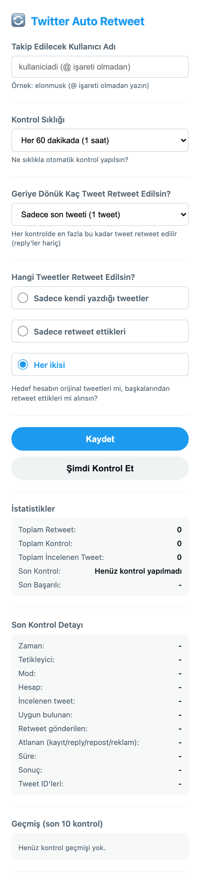

# 🔁 Twitter Auto Retweet

> A Chrome extension that automatically retweets a chosen X/Twitter account on a schedule — with history, filters and human-like delays.

  

Twitter Auto Retweet is a personal-use Chrome extension for keeping up with one account's posts. Set a username, choose a check interval (15, 30 or 60 minutes), pick how many recent tweets to consider, and let the extension retweet only items it has not seen before. It stores the last 200 tweet IDs locally and skips replies and promoted posts.

It uses your existing logged-in X session. There is no paid API, no token, no password field and no server.

## 📸 Screenshot

  
   
  The real extension popup: target account, schedule, tweet type, save/check buttons and statistics.

## ✨ Features

- 🔄 **Scheduled retweets** — every 15, 30 or 60 minutes via the Chrome Alarms API.
- 🔢 **Backlog control** — retweet the last 1–10 matching tweets per run.
- 🎯 **Tweet type filter** — original tweets only, retweets only, or both.
- 💾 **History** — last 200 retweeted tweet IDs, so nothing is posted twice.
- 🤖 **Human-like behaviour** — randomized delays in the fallback UI mode.
- 📊 **Statistics** — total retweets, checks, reviewed tweets, last check and last successful action.
- 🧪 **Two modes** — a lightweight JSON path (FxTwitter public API + X GraphQL) and a classic browser-click fallback.
- 🔒 **Local-only data** — settings and history stay in `chrome.storage.local`.

## 🚀 Install

1. Download or clone this repository.
2. Open `chrome://extensions`.
3. Enable **Developer mode**.
4. Click **Load unpacked** and select this folder.
5. Open the extension popup, enter a username (without `@`), choose an interval and click **Kaydet**.

For automatic checks, keep the browser running and stay signed in to X. The extension can open a tab if needed.

## ⚙️ How it works

1. `chrome.alarms` triggers a check at the chosen interval.
2. **Lightweight mode:** the last tweets are fetched as JSON from the public FxTwitter API; retweeting uses X's `CreateRetweet` GraphQL endpoint with your existing cookies.
3. **Fallback mode:** if the lightweight path fails (session, rate limit or a changed query ID), the extension opens the profile, finds `article[data-testid="tweet"]`, and clicks the retweet controls with delays.
4. Replies, promoted posts and previously handled IDs are filtered out.
5. The tweet ID is saved to history and the statistics are updated.

## 🔒 Privacy and safety

- No paid API, no developer tokens and no password collection.
- Read requests go to a public API; write requests go only to x.com under your own session.
- Data never leaves Chrome's local storage.
- Use the extension within X's terms. Avoid aggressive intervals and spam-like behaviour.
- This is an unofficial tool and is not affiliated with X Corp.

## 🛠️ Troubleshooting

| Problem | Fix |
| --- | --- |
| "Tweet bulunamadı" | Check the username (no `@`) and make sure the profile loads. |
| Wrong account's tweet is retweeted | Check the tweet-type filter; replies are always skipped. |
| Retweet button not found | Refresh X and confirm you are signed in. |
| Automatic checks stop | Ensure the extension is enabled and Chrome is running. |

## ❤️ Support

If this extension saves you time, you can buy me a coffee:

  

## 📄 License

[MIT](LICENSE) © 2026 Cem Türker.

Twitter Auto Retweet is an independent project and is not affiliated with X Corp.
